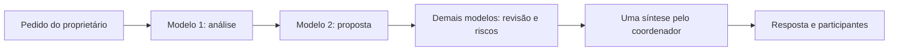

> **v2.7.0:** a equipe é automática nas conversas padrão. Não é necessário enviar `/chat equipe on`. O comando continua como escolha manual opcional. Para voz e início ao logar, siga o [guia atual](GUIA_AUTOMATICO.md).

# Todos os modelos trabalhando no assistente — v2.6.0

O Llama individual em CPU já respondeu no PC. A equipe cooperativa aproveita todos os modelos do catálogo Ollama selecionado, com análise, proposta, revisão e verificação. Cada modelo recebe o pedido e resumos limitados das contribuições anteriores; um coordenador produz a resposta final. O objetivo é combinar contribuições úteis, mantendo visíveis falhas e limitações.

## Ativar no Telegram

1. Encerre o assistente antigo e atualize todos os arquivos de código na raiz de `C:\Users\Mestre\Documents\GitHub\Mestre`. Preserve `.venv`, `F:\MeuControlePC_v2\.env` e `F:\MeuControlePC_v2\dados`.
2. Execute `iniciar_redirecionado.bat` e confira a versão **2.6.0**. Mantenha o perfil CPU que funcionou. A atualização não muda o perfil nem ativa equipes automaticamente.
3. No Telegram, na conversa desejada, envie:

   ```text
   /chat equipe on
   ```

   A ativação consulta o catálogo e salva todas as tags listadas, até oito. Não gera respostas nem baixa modelos. A mensagem informa os participantes. Não envie novamente `/modelos perfil cpu` depois: esse comando seleciona o Llama individual e desliga a equipe daquela conversa.
4. Envie um objetivo concreto, como “Compare três formas de organizar meus estudos e proponha um plano com vantagens e riscos”. O bot atualiza uma mensagem com o modelo em consulta e a etapa de síntese. Aguarde o resultado antes de enviar outra pergunta à mesma conversa.

Para reler o catálogo após instalar/remover uma tag, envie novamente `/chat equipe on`. A lista fica salva por conversa; a equipe não baixa modelos para completar nomes ausentes. `/chats` mostra o modo e os participantes atuais. O painel local também permite ativar/atualizar a equipe cooperativa.

## Como os modelos participam



Cada participante recebe uma chamada, em sequência, com histórico isolado e contribuições anteriores resumidas. Se dois ou mais responderem, há no máximo uma chamada extra para síntese. O coordenador é escolhido entre os que responderam, com preferência pelo Llama 3.2. Se somente um responder, sua contribuição é apresentada sem outra geração. A falha de um modelo não interrompe as tentativas dos demais; o resultado identifica quem respondeu e quem falhou. Não há repetição automática.

As chamadas cooperativas solicitam contexto 4096, até 384 tokens de saída e `keep_alive=0`, para liberar o modelo após a chamada. Com o perfil CPU ativo, também solicitam `num_gpu=0`. Essas opções pertencem às chamadas da equipe; a conversa individual mantém seu perfil compacto de contexto 1024/128 tokens. A aplicação não aumenta os limites de residência/paralelismo do servidor.

Os quatro pesos informados somam aproximadamente 25,6 GiB; o PC tem 16 GiB de RAM e 6 GiB de VRAM. A sequência reduz a disputa entre modelos, mas o 27B pode continuar lento ou sem recursos. O tamanho do modelo não é reduzido pelo perfil CPU. Um resultado parcial será mostrado como parcial. A qualidade final depende dos modelos e do pedido; usar mais modelos não garante uma resposta melhor em todos os casos.

Cada chamada mantém o timeout Ollama configurado, limitado entre 5 e 120 segundos de espera de rede. Com oito modelos e síntese, a equipe pode levar vários minutos. O painel permite até 20 minutos para receber a resposta e preserva sua recuperação por consulta sem repetir o POST se a conexão for perdida. Não inicie outras gerações pesadas enquanto verifica a equipe no PC.

## Dados locais, ações e voz

Pedidos reconhecidos como “Mostre a minha rotina da semana” consultam diretamente os registros existentes. As consultas locais conhecidas não precisam de uma rodada de modelos nem permitem que a IA invente sua rotina. Pedidos mais livres usam o histórico da conversa e a equipe selecionada.

Os modelos podem propor uma ação permitida. Para preparar essa ação no modo cooperativo, todos os participantes precisam responder e concordar exatamente com os mesmos campos; a síntese precisa ser compatível. Uma falha ou divergência impede o plano. O proprietário ainda precisa confirmar a alteração. A síntese nunca fornece autorização para executar código, shell ou macros arbitrárias. Ações locais já reconhecidas continuam usando sua validação e confirmação normais.

O áudio da imagem falhou no caminho de transcrição Gemini. Os modelos Ollama de texto instalados não transcrevem áudio. Nesta versão, o bot informa se falta configuração, se o Gemini está em pausa ou se a credencial foi rejeitada antes de baixar/enviar áudio. Uma transcrição disponível é encaminhada ao mesmo fluxo de conversa e confirmação do texto. Não há instalação/download de modelo de voz. O áudio é enviado em memória ao Gemini configurado, sem arquivo temporário ou upload persistente, em uma tentativa. Enquanto esse provedor estiver indisponível, envie texto.

A equipe desta conversa usa o catálogo Ollama. Gemini, OpenAI e Claude continuam disponíveis pela equipe de provedores `/equipe OBJETIVO`, quando configurados e liberados, com a confirmação já existente. Exa continua sendo pesquisa. Créditos, permissões e disponibilidade desses serviços precisam existir; chaves rejeitadas não são recuperadas por alternar modelos locais. Tags cloud do Ollama usam conta/internet/cota e são bloqueadas pelo perfil CPU.

## Compatibilidade e reversão

Conversas antigas que já tinham equipe paralela mantêm esse modo até serem reativadas. `/chat equipe on` ou `/chat equipe cooperativa` escolhe cooperação sequencial. `/chat equipe paralelo` continua disponível para solicitar consultas simultâneas explicitamente, com consumo maior de memória e sem síntese extra. `/chat equipe off` desativa a equipe e preserva o histórico.

Escolher modelo/provedor individual, definir o padrão ou ativar um perfil CPU/padrão desliga a equipe daquela conversa, como antes. O perfil de execução Ollama continua global; o modo/participantes da equipe pertencem à conversa.

Para reverter só a equipe, use `/chat equipe off` e continue com o Llama CPU. Para reverter o código, restaure todas as fontes v2.5.2 preservando configuração e dados. O campo adicional `equipe_modo` é compatível com a leitura anterior; desative a equipe antes de voltar, pois a v2.5.2 executa equipes ativas em paralelo. Nenhuma migração destrutiva foi adicionada.
